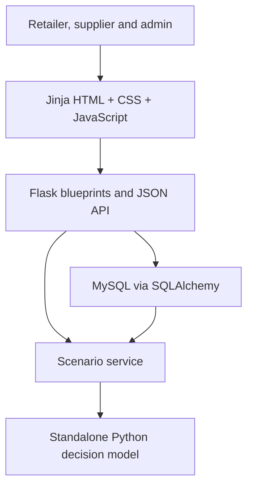
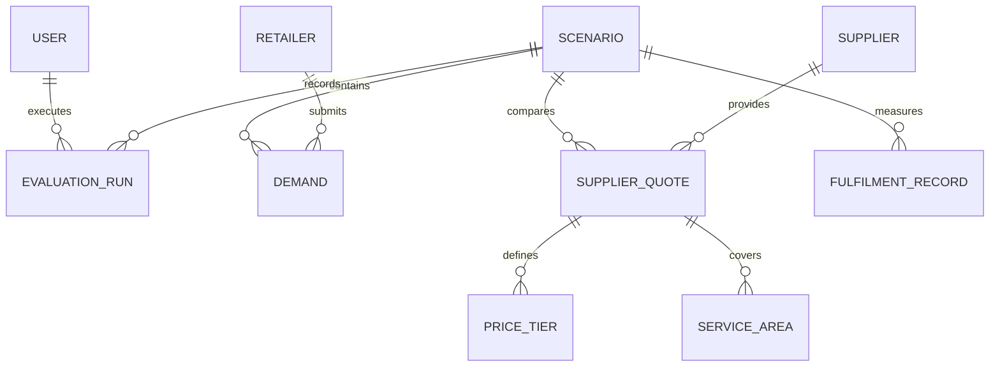

# System design pack

## Figure 1. ButcherBridge application architecture

The decision model imports neither Flask nor database code. Routes validate requests, services adapt relational records into plain dictionaries, and the model returns a serialisable decision result.

## Figure 2. Normalised entity-relationship diagram

## Main end-to-end flows

1. Retailer baseline and demand: authenticated user captures quantity, date, area and actual current KPIs; the API validates and persists a demand commitment.
2. Supplier quotation: authorised supplier/admin captures tiers, capacity, areas, lead time and fulfilment/service estimates; the API normalises tiers and areas into child tables.
3. Decision evaluation: scenario service loads inputs, the pure Python engine filters demand, screens constraints, allocates capacity, calculates alternatives and persists the result snapshot.
4. Performance feedback: completed quantities, dates, cost, logistics, trips and distance are recorded; actual cost/kg, fill rate and on-time performance are calculated.

